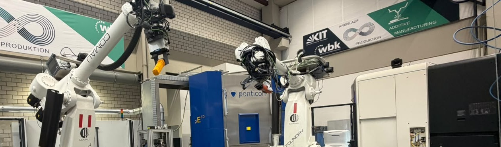

  

  
  

### Hi there 👋, I'm Hossam

I'm a Robotics and Automation Engineering student at the German International University (GIU), currently writing my bachelor thesis at the **wbk Institute of Production Science, Karlsruhe Institute of Technology (KIT)**.

My thesis explores how an LLM agent can write and verify its own robot programs for an industrial Comau robot cell, using simulation as the safety check before anything runs on real hardware.

I'm interested in **industrial robotics, AI for manufacturing, and simulation-driven robot programming**.

---

### 🔧 Projects

| Project | What it is |
|---|---|
| **[comau-gcode-agent](https://github.com/HossameldinYasser/comau-gcode-agent)** | LLM agent that writes G-code for a Comau NJ 290 robot cell and verifies it in PyBullet simulation (bachelor thesis) |
| **Quadruped leg** | Capstan-driven robot leg with ODrive motor control over CAN bus, simulated in Gazebo |
| **4-DOF robotic arm** | DH-parameter kinematics and servo control on Arduino |
| **EMG gesture recognition** | Ensemble ML classifier for hand gestures from EMG signals |

### 🛠️ Tools I work with

If you'd like to collaborate or talk robotics, feel free to reach out!
