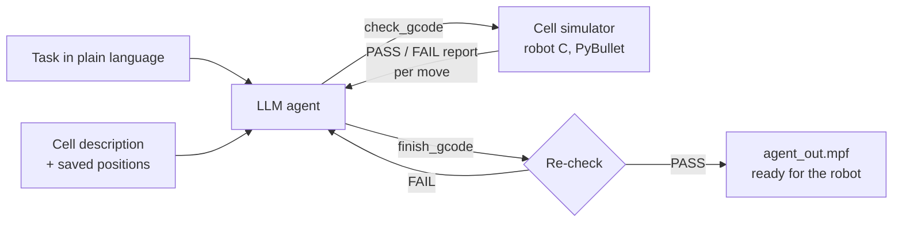

# comau-gcode-agent

**An LLM agent that writes and self-checks G-code for an industrial Comau robot.**

**Bachelor thesis** · wbk Institute of Production Science, Karlsruhe Institute of Technology (KIT) · Oct 2026 – Jan 2027
Supervisor: Jan Baumgärtner

> *Policy-as-Code for Integrating Process Workstations into Robotic Assembly and Disassembly Systems*

An LLM agent that writes G-code for a **Comau NJ 290-3.0** industrial robot (Siemens SINUMERIK controller) and checks its own programs in simulation before they ever reach the real cell.

The agent gets **no code examples**. It only gets a plain-language description of the robot cell, a file of positions measured at the real robot, and a simulator it can call as a tool. It writes a program, runs it in the simulator, reads the report, fixes every failure, and only submits once the simulator says **PASS**.

🚧 **Status:** work in progress. The thesis runs until January 2027.

---

## How it works



1. The agent reads the task and plans positions, order and safe heights.
2. It writes the full G-code program and calls `check_gcode`.
3. The simulator plays the program on robot C and reports, per move: whether the target was reached (error under 5 mm), the distance to the closest object, and any no-go zone violations.
4. The agent fixes every FAIL and tries again (up to 8 rounds).
5. When it calls `finish_gcode`, the program is **checked again** before it's saved, so the agent can't submit an unverified program.

### Safety rules the simulator enforces
- Never below the floor (Z = 0)
- No contact with anything in the cell
- Respect no-go zones (e.g. the press and its lever)
- If a needed position is missing, the agent must stop and say so instead of inventing coordinates

---

## Repository structure

```
agent/              The agent: loop, simulator check, cell description, saved positions
sim_extensions/     Additions to the wbk cell simulation (press machine model, helpers)
experiments/        Programs generated by the agent during test runs, and a script to compare runs
robot_programs/     Hand-written G-code test programs
patches/            My changes to the wbk simulator (DisassemblySim.py), as a diff
docs/               Notes and figures
```

---

## Running it

This code runs **on top of wbk's `crc_disassembly_sim`** cell simulation, which is not included here.

```bash
pip install anthropic pybullet numpy
export ANTHROPIC_API_KEY=your_key_here
export PYTHONPATH=/path/to/crc_disassembly_sim:$PYTHONPATH

cd agent
python3 agent_loop.py "Move to template_point_1, wait 3 seconds, move 100 mm to the right, return"
```

If the simulator reports PASS, the final program is written to `agent/agent_out.mpf`.

---

## Built with
Python · PyBullet · [pybullet_industrial](https://github.com/WBK-Robotics/pybullet_industrial) · Anthropic Claude API · Siemens SINUMERIK G-code
